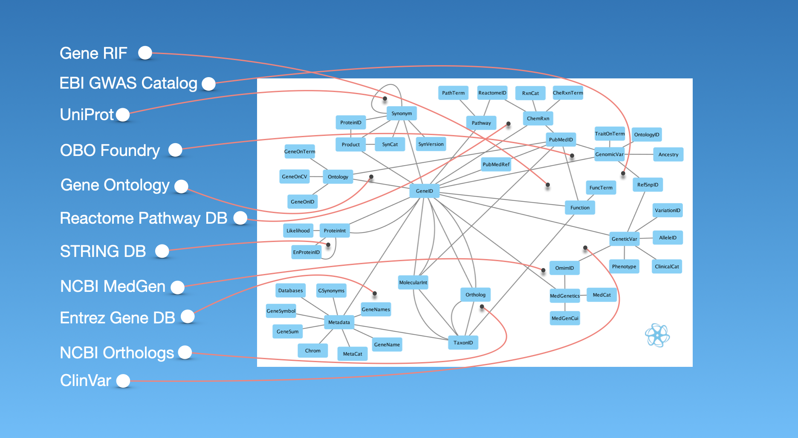

###### September 5, 2026: interlace-ex readme v8

# interlace-ex

Welcome to **interlace-ex**! An educational repository consisting of **interlace-go** applications for consolidating human gene data, including products, interactants, genetic variants, and disease.

## Contents

1) [Introduction](#1-introduction)
2) [Data Providers](#2-data-providers)
3) [Data Creators and Peer-reviewed Journal References](#3-data-creators-and-peer-reviewed-journal-references)
4) Cloning
5) Compiling
6) Downloading
7) Interlacing
8) Innovating

### 1. Introduction

The software engineering outcome of **interlace-ex** consolidates 57 GB of uncompressed gene and disease information into 1.4 GB of refined **interlace-go** binary data assets, ready to load into memory and power up basic research. Consolidation and data refinement take less than five minutes on a modern personal computer. This enables daily updates across [23 IP addresses](configs/input/url.txt). Nonetheless, this work aims to help innovators learn to use the **interlace-go** packages to create tailor-made datastacks in any data domain. 

[15 Go programs](./cmd/README.md) are offered as code examples to guide the use of **interlace-go** for writing command-line applications. These program examples create one **Interlace Entity**, named *Gene*, and **14 Interlace Assets**:

1) *Gene* Product
2) *Gene* Synonym
3) *Gene* Metadata
4) *Gene* PubMed Reference
5) *Gene* Function
6) *Gene* Ontology
7) *Gene* Medical Genetics
8) *Gene* Ortholog
9) *Gene* Molecular Interaction
10) *Gene* Genetic Variation
11) *Gene* Genomic Variation & Ancestry
12) *Gene* Pathway
13) *Gene* Chemical Reaction
14) *Gene* Protein Interaction

The **interlace-ex** repository provides tools to crystallize knowledge from all known genes in the human genome, along with code examples to help you build your own **interlace-go** data assets. 

### 2. Data Providers

- [Ancestry category label distribution in the GWAS Catalog](https://www.ebi.ac.uk/gwas/docs/ancestry-data)
- [NCBI ClinVar](https://www.ncbi.nlm.nih.gov/clinvar/)
- [EBI GWAS Catalog](https://www.ebi.ac.uk/gwas/)
- [Gender, Sex, and Sexual Orientation ontology](https://obofoundry.org/ontology/gsso.html)
- [NCBI GeneRIF](https://www.ncbi.nlm.nih.gov/gene/about-generif)
- [Gene Ontology](https://www.geneontology.org/)
- [Human Phenotype Ontology](https://hpo.jax.org/)
- [NCBI MedGen](https://www.ncbi.nlm.nih.gov/medgen/)
- [Mondo Disease Ontology](https://mondo.monarchinitiative.org/)
- [NCBI Gene DB](https://www.ncbi.nlm.nih.gov/gene/)
- [Ontology of Biological Attributes](https://github.com/obophenotype/bio-attribute-ontology)
- [Open Biological and Biomedical Ontology Foundry](https://obofoundry.org/)
- [Reactome](https://reactome.org/)
- [STRING DB](https://string-db.org/)
- [UniProt](https://www.uniprot.org/)

### 3. Data Creators and Peer-reviewed Journal References

#### [A standardized framework for representation of ancestry data in genomics studies, with application to the NHGRI-EBI GWAS Catalog.](https://pubmed.ncbi.nlm.nih.gov/29448949/)

Morales J, Welter D, Bowler EH, Cerezo M, Harris LW, McMahon AC, Hall P, Junkins HA, Milano A, Hastings E, Malangone C, Buniello A, Burdett T, Flicek P, Parkinson H, Cunningham F, Hindorff LA, MacArthur JAL.

Genome Biol. 2018 Feb 15;19(1):21.

doi: 10.1186/s13059-018-1396-2. PMID: 29448949; PMCID: PMC5815218.

#### [ClinVar: public archive of relationships among sequence variation and human phenotype.](https://pubmed.ncbi.nlm.nih.gov/24234437/)

Landrum MJ, Lee JM, Riley GR, Jang W, Rubinstein WS, Church DM, Maglott DR.

Nucleic Acids Res. 2014 Jan; 42 (Database issue): D980-5.

doi: 10.1093/nar/gkt1113. Epub 2013 Nov 14. PMID: 24234437; PMCID: PMC3965032.

#### [The Human Phenotype Ontology in 2024: phenotypes around the world.](https://pubmed.ncbi.nlm.nih.gov/37953324/)

Gargano MA, Matentzoglu N, Coleman B, Addo-Lartey EB, Anagnostopoulos AV, Anderton J, Avillach P, Bagley AM, Bakštein E, Balhoff JP, Baynam G, Bello SM, Berk M, Bertram H, Bishop S, Blau H, Bodenstein DF, Botas P, Boztug K, Čady J, Callahan TJ, Cameron R, Carbon SJ, Castellanos F, Caufield JH, Chan LE, Chute CG, Cruz-Rojo J, Dahan-Oliel N, Davids JR, de Dieuleveult M, de Souza V, de Vries BBA, de Vries E, DePaulo JR, Derfalvi B, Dhombres F, Diaz-Byrd C, Dingemans AJM, Donadille B, Duyzend M, Elfeky R, Essaid S, Fabrizzi C, Fico G, Firth HV, Freudenberg-Hua Y, Fullerton JM, Gabriel DL, Gilmour K, Giordano J, Goes FS, Moses RG, Green I, Griese M, Groza T, Gu W, Guthrie J, Gyori B, Hamosh A, Hanauer M, Hanušová K, He YO, Hegde H, Helbig I, Holasová K, Hoyt CT, Huang S, Hurwitz E, Jacobsen JOB, Jiang X, Joseph L, Keramatian K, King B, Knoflach K, Koolen DA, Kraus ML, Kroll C, Kusters M, Ladewig MS, Lagorce D, Lai MC, Lapunzina P, Laraway B, Lewis-Smith D, Li X, Lucano C, Majd M, Marazita ML, Martinez-Glez V, McHenry TH, McInnis MG, McMurry JA, Mihulová M, Millett CE, Mitchell PB, Moslerová V, Narutomi K, Nematollahi S, Nevado J, Nierenberg AA, Čajbiková NN, Nurnberger JI Jr, Ogishima S, Olson D, Ortiz A, Pachajoa H, Perez de Nanclares G, Peters A, Putman T, Rapp CK, Rath A, Reese J, Rekerle L, Roberts AM, Roy S, Sanders SJ, Schuetz C, Schulte EC, Schulze TG, Schwarz M, Scott K, Seelow D, Seitz B, Shen Y, Similuk MN, Simon ES, Singh B, Smedley D, Smith CL, Smolinsky JT, Sperry S, Stafford E, Stefancsik R, Steinhaus R, Strawbridge R, Sundaramurthi JC, Talapova P, Tenorio Castano JA, Tesner P, Thomas RH, Thurm A, Turnovec M, van Gijn ME, Vasilevsky NA, Vlčková M, Walden A, Wang K, Wapner R, Ware JS, Wiafe AA, Wiafe SA, Wiggins LD, Williams AE, Wu C, Wyrwoll MJ, Xiong H, Yalin N, Yamamoto Y, Yatham LN, Yocum AK, Young AH, Yüksel Z, Zandi PP, Zankl A, Zarante I, Zvolský M, Toro S, Carmody LC, Harris NL, Munoz-Torres MC, Danis D, Mungall CJ, Köhler S, Haendel MA, Robinson PN.

Nucleic Acids Res. 2024 Jan 5;52(D1):D1333-D1346.

doi: 10.1093/nar/gkad1005. PMID: 37953324; PMCID: PMC10767975.

#### [Gene: a gene-centered information resource at NCBI.](https://pubmed.ncbi.nlm.nih.gov/25355515/)

Brown GR, Hem V, Katz KS, Ovetsky M, Wallin C, Ermolaeva O, Tolstoy I, Tatusova T, Pruitt KD, Maglott DR, Murphy TD.

Nucleic Acids Res. 2015 Jan; 43 (Database issue): D36-42.

doi: 10.1093/nar/gku1055. Epub 2014 Oct 29. PMID: 25355515; PMCID: PMC4383897.

#### [The Gene Ontology knowledgebase in 2023.](https://pubmed.ncbi.nlm.nih.gov/36866529/)

Gene Ontology Consortium; Aleksander SA, Balhoff J, Carbon S, Cherry JM, Drabkin HJ, Ebert D, Feuermann M, Gaudet P, Harris NL, Hill DP, Lee R, Mi H, Moxon S, Mungall CJ, Muruganugan A, Mushayahama T, Sternberg PW, Thomas PD, Van Auken K, Ramsey J, Siegele DA, Chisholm RL, Fey P, Aspromonte MC, Nugnes MV, Quaglia F, Tosatto S, Giglio M, Nadendla S, Antonazzo G, Attrill H, Dos Santos G, Marygold S, Strelets V, Tabone CJ, Thurmond J, Zhou P, Ahmed SH, Asanitthong P, Luna Buitrago D, Erdol MN, Gage MC, Ali Kadhum M, Li KYC, Long M, Michalak A, Pesala A, Pritazahra A, Saverimuttu SCC, Su R, Thurlow KE, Lovering RC, Logie C, Oliferenko S, Blake J, Christie K, Corbani L, Dolan ME, Drabkin HJ, Hill DP, Ni L, Sitnikov D, Smith C, Cuzick A, Seager J, Cooper L, Elser J, Jaiswal P, Gupta P, Jaiswal P, Naithani S, Lera-Ramirez M, Rutherford K, Wood V, De Pons JL, Dwinell MR, Hayman GT, Kaldunski ML, Kwitek AE, Laulederkind SJF, Tutaj MA, Vedi M, Wang SJ, D'Eustachio P, Aimo L, Axelsen K, Bridge A, Hyka-Nouspikel N, Morgat A, Aleksander SA, Cherry JM, Engel SR, Karra K, Miyasato SR, Nash RS, Skrzypek MS, Weng S, Wong ED, Bakker E, Berardini TZ, Reiser L, Auchincloss A, Axelsen K, Argoud-Puy G, Blatter MC, Boutet E, Breuza L, Bridge A, Casals-Casas C, Coudert E, Estreicher A, Livia Famiglietti M, Feuermann M, Gos A, Gruaz-Gumowski N, Hulo C, Hyka-Nouspikel N, Jungo F, Le Mercier P, Lieberherr D, Masson P, Morgat A, Pedruzzi I, Pourcel L, Poux S, Rivoire C, Sundaram S, Bateman A, Bowler-Barnett E, Bye-A-Jee H, Denny P, Ignatchenko A, Ishtiaq R, Lock A, Lussi Y, Magrane M, Martin MJ, Orchard S, Raposo P, Speretta E, Tyagi N, Warner K, Zaru R, Diehl AD, Lee R, Chan J, Diamantakis S, Raciti D, Zarowiecki M, Fisher M, James-Zorn C, Ponferrada V, Zorn A, Ramachandran S, Ruzicka L, Westerfield M.

Genetics. 2023 May 4;224(1):iyad031.

doi: 10.1093/genetics/iyad031. PMID: 36866529; PMCID: PMC10158837.

#### [GeneRIF indexing: sentence selection based on machine learning.](https://pubmed.ncbi.nlm.nih.gov/23725347/)

Jimeno-Yepes AJ, Sticco JC, Mork JG, Aronson AR.

BMC Bioinformatics. 2013 May 31;14:171.

doi: 10.1186/1471-2105-14-171. PMID: 23725347; PMCID: PMC3687823.

#### [MedGen: NCBI's Portal to Information on Medical Conditions with a Genetic Component.](https://pubmed.ncbi.nlm.nih.gov/32329672/)

Louden DN.

Med Ref Serv Q. 2020 Apr-Jun; 39(2): 183-191.

doi: 10.1080/02763869.2020.1726152. PMID: 32329672.

#### [Mondo: Integrating Disease Terminology Across Communities.](https://pubmed.ncbi.nlm.nih.gov/41052288/)

Vasilevsky NA, Toro S, Matentzoglu N, Flack JE, Mullen KR, Hegde H, Gehrke S, Whetzel PL, Shwetar Y, Harris NL, Ngu MS, Alyea GL, Kane MS, Roncaglia P, Sid E, Thaxton CL, Wood V, Abraham RS, Achatz MI, Ajuyah P, Amberger JS, Babb L, Baker J, Balhoff JP, Berg JS, Bhalla A, Bofill-De Ros X, Braun IR, Broeren EC, Byer BK, Byrne AB, Callahan TJ, Carmody LC, Chan LE, Clause AR, Cohen JS, DeLuca M, Deuitch NT, Flowers M, Fraser J, Fujiwara T, Gitau V, Goldstein JL, Gration D, Groza T, Gyori BM, Hankey W, Hilton JA, Himmelstein DS, Hong SS, Hoyt CT, Huether R, Hurwitz E, Jacobsen JOB, Kikuchi A, Köhler S, Korn DR, Lagorce D, Laraway BJ, Li JY, Malheiro AJ, McLaughlin J, Meldal BHM, Mohan S, Moxon SAT, Munoz-Torres MC, Nelson TH, Nicholas FW, Ochoa D, Olson D, Oprea TI, Oskotsky TT, Osumi-Sutherland D, Paris K, Parkinson HE, Pendlington ZM, Peng XP, Pizzino A, Plon SE, Powell BC, Ratliff JC, Rehm HL, Remennik L, Riggs ER, Roberts S, Robinson PN, Ross JE, Schaper K, Schilder BM, Schmidt JL, Sharp EW, Similuk MN, Smedley D, Sneddon TP, Sparks R, Stefancsik R, Stupp GS, Sundar S, Takatsuki T, Tammen I, Tshering KC, Unni DR, Valasek E, Vanderver A, Wagner AH, Webb RF, Welter D, Yaya-Stupp D, Zankl A, Zhang XA, McMurry JA, Chute CG, Hamosh A, Mungall CJ, Haendel MA.

Genetics. 2025 Oct 6:iyaf215.

doi: 10.1093/genetics/iyaf215. Epub ahead of print. PMID: 41052288.

#### [The NHGRI-EBI GWAS Catalog: standards for reusability, sustainability, and diversity.](https://pubmed.ncbi.nlm.nih.gov/39530240/)

Cerezo M, Sollis E, Ji Y, Lewis E, Abid A, Bircan KO, Hall P, Hayhurst J, John S, Mosaku A, Ramachandran S, Foreman A, Ibrahim A, McLaughlin J, Pendlington Z, Stefancsik R, Lambert SA, McMahon A, Morales J, Keane T, Inouye M, Parkinson H, Harris LW.

Nucleic Acids Res. 2025 Jan 6; 53(D1): D998-D1005.

doi: 10.1093/nar/gkae1070. PMID: 39530240; PMCID: PMC11701593.

#### [The Ontology of Biological Attributes (OBA)-computational traits for the life sciences.](https://pubmed.ncbi.nlm.nih.gov/37076585/)

Stefancsik R, Balhoff JP, Balk MA, Ball RL, Bello SM, Caron AR, Chesler EJ, de Souza V, Gehrke S, Haendel M, Harris LW, Harris NL, Ibrahim A, Koehler S, Matentzoglu N, McMurry JA, Mungall CJ, Munoz-Torres MC, Putman T, Robinson P, Smedley D, Sollis E, Thessen AE, Vasilevsky N, Walton DO, Osumi-Sutherland D.

Mamm Genome. 2023 Sep;34(3):364-378.

doi: 10.1007/s00335-023-09992-1. Epub 2023 Apr 19. PMID: 37076585; PMCID: PMC10382347.

#### [The Reactome Pathway Knowledgebase 2024.](https://pubmed.ncbi.nlm.nih.gov/37941124/)

Milacic M, Beavers D, Conley P, Gong C, Gillespie M, Griss J, Haw R, Jassal B, Matthews L, May B, Petryszak R, Ragueneau E, Rothfels K, Sevilla C, Shamovsky V, Stephan R, Tiwari K, Varusai T, Weiser J, Wright A, Wu G, Stein L, Hermjakob H, D'Eustachio P.

Nucleic Acids Res. 2024 Jan 5; 52(D1): D672-D678.

doi: 10.1093/nar/gkad1025. PMID: 37941124; PMCID: PMC10767911.

#### [The STRING database in 2023: protein-protein association networks and functional enrichment analyses for any sequenced genome of interest.](https://pubmed.ncbi.nlm.nih.gov/36370105/)

Szklarczyk D, Kirsch R, Koutrouli M, Nastou K, Mehryary F, Hachilif R, Gable AL, Fang T, Doncheva NT, Pyysalo S, Bork P, Jensen LJ, von Mering C.

Nucleic Acids Res. 2023 Jan 6; 51(D1): D638-D646.

doi: 10.1093/nar/gkac1000. PMID: 36370105; PMCID: PMC9825434.

#### [UniProt: the Universal Protein Knowledgebase in 2025.](https://pubmed.ncbi.nlm.nih.gov/39552041/)

UniProt Consortium.

Nucleic Acids Res. 2025 Jan 6; 53(D1): D609-D617.

doi: 10.1093/nar/gkae1010. PMID: 39552041; PMCID: PMC11701636.
