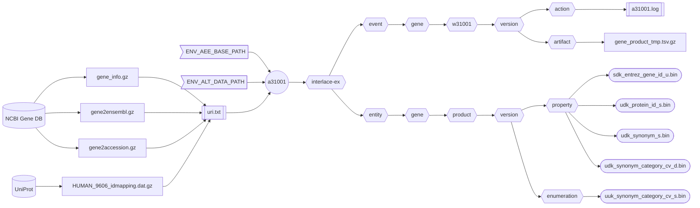

###### September 4, 2026: interlace-ex cmd a31001 readme v11

# [a31001]

Creates the human **Gene Product** asset from the NCBI [Gene DB] and [UniProt].



##### Flowchart Legend

- ⬡ **Hexagons:** Interlace folder hierarchy 
- ⛁ **Cylinders:** External data providers
- ◯ **Circles:** Interlace Go applications
- 𓉴 **Flags:** Environment variables
- 𓋰 **Ovals:** Interlace Go binary assets
- 𓈙 **Rectangles:** | Raw data files | or || configuration/log files ||

## Contents

1) [Help Page](#1-help-page)
2) [URI Input File](#2-uri-input-file)
3) [Requirements](#3-requirements)
4) [Environment Variables](#4-environment-variables)
5) [Command Line Example](#5-command-line-example)
6) [Log Example](#6-log-example)
7) [Output Example](#7-output-example)

### 1. Help Page

The help page is available with the `-help` option or when no arguments are provided.

```text
Project: interlace-ex
AppName: a31001
Version: beta_2026_08_31_12
Purpose: creates the Homo sapiens Gene entity Product asset from NCBI Gene DB and UniProt.

Sources:

  1) gene_info.gz
  2) gene2ensembl.gz
  3) gene2accession.gz
  4) HUMAN_9606_idmapping.dat.gz

Options:

  -base-concept string
        Base concept ontology term to name the entity folder (default "gene")
  -base-path string
        Agent, event, and entity base path (default "/Users/foglio/interlace-ex")
  -config string
        Config file (optional)
  -data-path string
        Data path where to read and download files (default "/Users/foglio/interlace-ex/data")
  -event-time-tag string
        Event time tag (required) (default "20260903220918")
  -help
        Displays this help page
  -log string
        Logfile path to write stderr & stdout regardless of the -silent flag (default no log file)
  -loud
        Writes additional information if available
  -no-commit
        Disables committing the work
  -no-delete
        Disables deleting the artifact files
  -no-download
        Disables downloading data when necessary
  -silent
        Suppresses all standard output messages
  -uri-inp-file string
        URI list of URL, mailto, telnet, absolute-file-path#key (unique key as URI fragment), etc.
  -workflow-id string
        Workflow ID (default "w31001")
```

### 2. URI Input File

```text
https://ftp.ncbi.nih.gov/gene/DATA/gene2accession.gz
https://ftp.ncbi.nih.gov/gene/DATA/gene2ensembl.gz
https://ftp.ncbi.nih.gov/gene/DATA/gene_info.gz
https://ftp.uniprot.org/pub/databases/uniprot/current_release/knowledgebase/idmapping/by_organism/HUMAN_9606_idmapping.dat.gz
```

### 3. Requirements
- Base path from the `-base-path` option or the environmental-variable `ENV_AEE_BASE_PATH`
- Data path from the `-data-path` option or the environmental-variable `ENV_ALT_DATA_PATH`
- URI list containing URLs and full-path file sources.

### 4. Environment Variables

```shell
ENV_AEE_BASE_PATH="${HOME}/interlace-ex"
ENV_ALT_DATA_PATH="${ENV_AEE_BASE_PATH}/data"
```

### 5. Command Line Example

```shell
a31001 -log a31001.log -event-time-tag 20260904150101 -uri-inp-file uri.txt
```

## 6. Log Example

```text
Inf: 2026/09/04 15:10:35.262989 application name: a31001
Inf: 2026/09/04 15:10:35.263141 application version: beta_2026_08_31_12
Inf: 2026/09/04 15:10:35.263158 application module: interlace-ex
Inf: 2026/09/04 15:10:35.263168 application aim: creates the Homo sapiens Gene entity Product asset from NCBI Gene DB and UniProt.
Inf: 2026/09/04 15:10:35.263176 application start time tag: 20260904151035
Inf: 2026/09/04 15:10:35.263183 listing configuration variables ...
Inf: 2026/09/04 15:10:35.263200 APP_REVISION: 12
Inf: 2026/09/04 15:10:35.263207 BASE_CONCEPT: gene
Inf: 2026/09/04 15:10:35.263214 BASE_PATH: /Users/foglio/interlace-ex
Inf: 2026/09/04 15:10:35.263220 DATA_PATH: /Users/foglio/interlace-ex/data
Inf: 2026/09/04 15:10:35.263226 ENV_AEE_BASE_PATH: /Users/foglio/interlace-ex
Inf: 2026/09/04 15:10:35.263233 ENV_ALT_DATA_PATH: /Users/foglio/interlace-ex/data
Inf: 2026/09/04 15:10:35.263239 EVENT_TIME_TAG: 20260904150101
Inf: 2026/09/04 15:10:35.263246 HOME: /Users/foglio
Inf: 2026/09/04 15:10:35.263252 LOG_OUTPUT_FILE: a31001.log
Inf: 2026/09/04 15:10:35.263258 URI_INP_FILE: uri.txt
Inf: 2026/09/04 15:10:35.263264 USER_LOGIN_NAME: foglio
Inf: 2026/09/04 15:10:35.263270 USER_NAME: Mario Foglio
Inf: 2026/09/04 15:10:35.263277 WORKFLOW_ID: w31001
Inf: 2026/09/04 15:10:35.263283 setting up the refiner ...
Inf: 2026/09/04 15:10:35.265106 file exists: /Users/foglio/interlace-ex/data/gene2ensembl.gz
Inf: 2026/09/04 15:10:35.265146 file exists: /Users/foglio/interlace-ex/data/gene2accession.gz
Inf: 2026/09/04 15:10:35.265209 file exists: /Users/foglio/interlace-ex/data/gene_info.gz
Inf: 2026/09/04 15:10:35.265446 file exists: /Users/foglio/interlace-ex/data/HUMAN_9606_idmapping.dat.gz
Inf: 2026/09/04 15:10:35.265476 creating the gene product asset ...
Inf: 2026/09/04 15:10:41.649469 total Entrez Gene Ensembl lines read: 19789503
Inf: 2026/09/04 15:10:41.649533 total Entrez Gene Ensembl table rows examined: 96207
Inf: 2026/09/04 15:10:41.649539 total Entrez Gene Ensembl tuples created: 253391
Inf: 2026/09/04 15:12:26.165498 total Entrez Gene RefSeq lines read: 285217184
Inf: 2026/09/04 15:12:26.166606 total Entrez Gene RefSeq table rows examined: 1693216
Inf: 2026/09/04 15:12:26.166619 total Entrez Gene RefSeq tuples created: 4140208
Inf: 2026/09/04 15:12:57.333804 total Entrez Gene synonyms lines read: 71719969
Inf: 2026/09/04 15:12:57.334093 total Entrez Gene synonyms table rows examined: 193812
Inf: 2026/09/04 15:12:57.334101 total Entrez Gene synonyms tuples created: 4474674
Inf: 2026/09/04 15:12:59.012653 total UniProt ID Map lines read: 5756700
Inf: 2026/09/04 15:12:59.012674 total UniProt ID Map table rows examined: 4774874
Inf: 2026/09/04 15:12:59.012680 total UniProt ID Map tuples created: 6406099
Inf: 2026/09/04 15:12:59.012697 total UniProt ID Map clusters without GeneID: 177098
Inf: 2026/09/04 15:12:59.015431 /Users/foglio/interlace-ex/event/gene/w31001/20260904150101/artifact/product_2203748148.tsv.gz size: 180210219
Inf: 2026/09/04 15:13:30.629658 number of warnings caught: 0
Inf: 2026/09/04 15:13:30.631592 elapsed time just before closing: 2m55.384785333s
Inf: 2026/09/04 15:13:30.631601 end of process: complete
```

## 7. Output Example

```text
interlace-ex/entity/gene/product
└── 20260904150101
    ├── catalog
    ├── enumeration
    │   └── uuk_synonym_category_cv_s.bin
    └── property
        ├── sdk_entrez_gene_id_u.bin
        ├── udk_protein_id_s.bin
        ├── udk_synonym_category_cv_d.bin
        └── udk_synonym_s.bin
        
interlace-ex/event/gene/w31001
└── 20260904150101
    ├── action
    │   └── 20260904151330_a31001.log
    ├── artifact
    └── function
```

[a31001]: ../../internal/app/a31001
[Gene DB]: https://www.ncbi.nlm.nih.gov/gene/
[UniProt]: https://www.uniprot.org/
