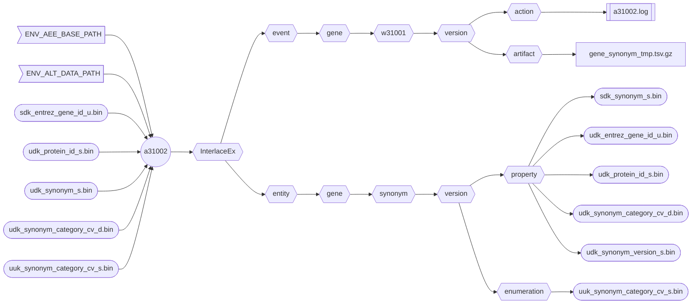

###### September 4, 2026: d60102 readme v10

# [a31002]

Creates the human **Gene Synonym** asset from the **Gene Product**.



##### Flowchart Legend

- ⬡ **Hexagons:** Interlace folder hierarchy
- ⛁ **Cylinders:** External data providers
- ◯ **Circles:** Interlace Go applications
- 𓉴 **Flags:** Environment variables
- 𓋰 **Ovals:** Interlace Go binary assets
- 𓈙 **Rectangles:** | Raw data files | or || configuration/log files ||

## Contents

1) [Help Page](#1-help-page)
2) [Requirements](#2-requirements)
3) [Environment Variables](#3-environment-variables)
4) [Command Line Example](#4-command-line-example)
5) [Log Example](#5-log-example)
6) [Output Example](#6-output-example)

### 1. Help Page

The help page is available with the `-help` option or when no arguments are provided.

```text
Project: interlace-ex
AppName: a31002
Version: beta_2026_08_30_12
Purpose: creates the Homo sapiens Gene entity Synonym asset from the NCBI Gene DB.

Sources:

  1) sdk_entrez_gene_id_u.bin
  2) udk_protein_id_s.bin
  3) udk_synonym_s.bin
  4) udk_synonym_category_cv_d.bin

Options:

  -base-concept string
        Base concept ontology term to name the entity folder (default "gene")
  -base-path string
        Agent, event, and entity base path (default "/Users/foglio/interlace-ex")
  -config string
        Config file (optional)
  -data-path string
        Data path where to read and download files (default "/Users/foglio/interlace-ex/data")
  -event-time-tag string
        Event time tag (required) (default "20260903223033")
  -help
        Displays this help page
  -log string
        Logfile path to write stderr & stdout regardless of the -silent flag (default no log file)
  -loud
        Writes additional information if available
  -no-commit
        Disables committing the work
  -no-delete
        Disables deleting the artifact files
  -no-download
        Disables downloading data when necessary
  -silent
        Suppresses all standard output messages
  -workflow-id string
        Workflow ID (default "w31001")
```

### 2. Requirements
- Base path from the `-base-path` option or the environmental-variable `ENV_AEE_BASE_PATH`
- Data path from the `-data-path` option or the environmental-variable `ENV_ALT_DATA_PATH`

### 3. Environment Variables

```shell
ENV_AEE_BASE_PATH="${HOME}/InterlaceEx"
ENV_ALT_DATA_PATH="${ENV_AEE_BASE_PATH}/data"
```

### 4. Command Line Example

```shell
a31002 -log a31002.log -event-time-tag 20260904150101
```

### 5. Log Example

```text
Inf: 2026/09/04 15:19:14.115514 application name: a31002
Inf: 2026/09/04 15:19:14.115570 application version: beta_2026_08_30_12
Inf: 2026/09/04 15:19:14.115580 application module: interlace-ex
Inf: 2026/09/04 15:19:14.115586 application aim: creates the Homo sapiens Gene entity Synonym asset from the NCBI Gene DB.
Inf: 2026/09/04 15:19:14.115590 application start time tag: 20260904151914
Inf: 2026/09/04 15:19:14.115594 listing configuration variables ...
Inf: 2026/09/04 15:19:14.115615 APP_REVISION: 12
Inf: 2026/09/04 15:19:14.115621 BASE_CONCEPT: gene
Inf: 2026/09/04 15:19:14.115625 BASE_PATH: /Users/foglio/interlace-ex
Inf: 2026/09/04 15:19:14.115628 DATA_PATH: /Users/foglio/interlace-ex/data
Inf: 2026/09/04 15:19:14.115632 ENV_AEE_BASE_PATH: /Users/foglio/interlace-ex
Inf: 2026/09/04 15:19:14.115636 ENV_ALT_DATA_PATH: /Users/foglio/interlace-ex/data
Inf: 2026/09/04 15:19:14.115639 EVENT_TIME_TAG: 20260904150101
Inf: 2026/09/04 15:19:14.115643 HOME: /Users/foglio
Inf: 2026/09/04 15:19:14.115646 LOG_OUTPUT_FILE: a31002.log
Inf: 2026/09/04 15:19:14.115650 USER_LOGIN_NAME: foglio
Inf: 2026/09/04 15:19:14.115653 USER_NAME: Mario Foglio
Inf: 2026/09/04 15:19:14.115657 WORKFLOW_ID: w31001
Inf: 2026/09/04 15:19:14.115660 setting up the refiner ...
Inf: 2026/09/04 15:19:14.115876 creating the gene synonym asset ...
Inf: 2026/09/04 15:19:16.779073 total Entrez Gene RIF lines read: 5919615
Inf: 2026/09/04 15:19:16.779096 total Entrez Gene RIF table rows examined: 5919615
Inf: 2026/09/04 15:19:16.779102 total Entrez Gene RIF tuples created: 5919615
Inf: 2026/09/04 15:19:16.781581 /Users/foglio/interlace-ex/event/gene/w31001/20260904150101/artifact/synonym_3290738602.tsv.gz size: 169293943
Inf: 2026/09/04 15:19:52.046259 number of warnings caught: 0
Inf: 2026/09/04 15:19:52.046660 elapsed time just before closing: 37.932452625s
Inf: 2026/09/04 15:19:52.046670 end of process: complete
```

### 6. Output Example

```text
interlace-ex/entity/gene/synonym
└── 20260904150101
    ├── catalog
    ├── enumeration
    │   └── uuk_synonym_category_cv_s.bin
    └── property
        ├── sdk_synonym_s.bin
        ├── udk_entrez_gene_id_u.bin
        ├── udk_protein_id_s.bin
        ├── udk_synonym_category_cv_d.bin
        └── udk_synonym_version_s.bin
    
interlace-ex/event/gene/w31001
└── 20260904150101
    ├── action
    │   ├── 20260904151330_a31001.log
    │   └── 20260904151952_a31002.log
    ├── artifact
    └── function
```

[a31002]: ../../internal/app/a31002
[a31001]: ../../internal/app/a31001
