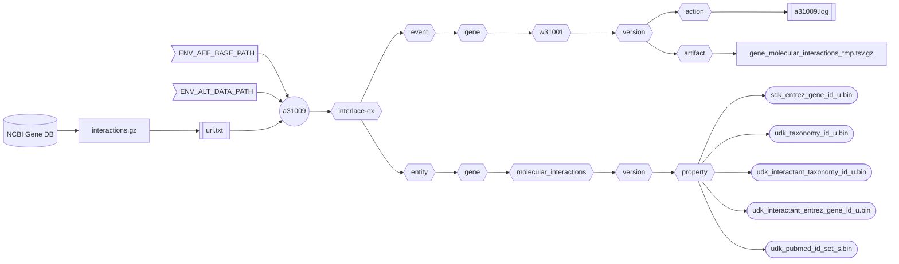

###### September 4, 2026: d60109 readme v13

# [a31009]

Creates the human **Gene Molecular Interaction** asset from the NCBI [Gene RIF].



##### Flowchart Legend

- ⬡ **Hexagons:** Interlace folder hierarchy
- ⛁ **Cylinders:** External data providers
- ◯ **Circles:** Interlace Go applications
- 𓉴 **Flags:** Environment variables
- 𓋰 **Ovals:** Interlace Go binary assets
- 𓈙 **Rectangles:** | Raw data files | or || configuration/log files ||

## Contents

1) [Help Page](#1-help-page)
2) [URI Input File](#2-uri-input-file)
3) [Requirements](#3-requirements)
4) [Environment Variables](#4-environment-variables)
5) [Command Line Example](#5-command-line-example)
6) [Log Example](#6-log-example)
7) [Output Example](#7-output-example)

### 1. Help Page

The help page is available with the `-help` option or when no arguments are provided.

```text
Project: interlace-ex
AppName: a31009
Version: beta_2026_08_31_13
Purpose: creates the Homo sapiens Gene entity Molecular Interaction asset from the NCBI Gene RIF.

Sources:

  1) interactions.gz

Options:

  -base-concept string
        Base concept ontology term to name the entity folder (default "gene")
  -base-path string
        Agent, event, and entity base path (default "/Users/foglio/interlace-ex")
  -config string
        Config file (optional)
  -data-path string
        Data path where to read and download files (default "/Users/foglio/interlace-ex/data")
  -event-time-tag string
        Event time tag (required) (default "20260904114805")
  -help
        Displays this help page
  -log string
        Logfile path to write stderr & stdout regardless of the -silent flag (default no log file)
  -loud
        Writes additional information if available
  -no-commit
        Disables committing the work
  -no-delete
        Disables deleting the artifact files
  -no-download
        Disables downloading data when necessary
  -silent
        Suppresses all standard output messages
  -uri-inp-file string
        URI list of URL, mailto, telnet, absolute-file-path#key (unique key as URI fragment), etc.
  -workflow-id string
        Workflow ID (default "w31001")
```

### 2. URI Input File

```text
https://ftp.ncbi.nih.gov/gene/GeneRIF/interactions.gz
```

### 3. Requirements
- Base path from the `-base-path` option or the environmental-variable `ENV_AEE_BASE_PATH`
- Data path from the `-data-path` option or the environmental-variable `ENV_ALT_DATA_PATH`
- URI list containing URLs and full-path file sources.

### 4. Environment Variables

```shell
ENV_AEE_BASE_PATH="${HOME}/interlace-ex"
ENV_ALT_DATA_PATH="${ENV_AEE_BASE_PATH}/data"
```

### 5. Command Line Example

```shell
a31009 -log a31009.log -event-time-tag 20260904150101 -uri-inp-file uri.txt
```

### 6. Log Example

```text
Inf: 2026/09/04 15:53:11.397246 application name: a31009
Inf: 2026/09/04 15:53:11.397296 application version: beta_2026_08_31_13
Inf: 2026/09/04 15:53:11.397307 application module: interlace-ex
Inf: 2026/09/04 15:53:11.397312 application aim: creates the Homo sapiens Gene entity Molecular Interaction asset from the NCBI Gene RIF.
Inf: 2026/09/04 15:53:11.397317 application start time tag: 20260904155311
Inf: 2026/09/04 15:53:11.397321 listing configuration variables ...
Inf: 2026/09/04 15:53:11.397341 APP_REVISION: 13
Inf: 2026/09/04 15:53:11.397345 BASE_CONCEPT: gene
Inf: 2026/09/04 15:53:11.397349 BASE_PATH: /Users/foglio/interlace-ex
Inf: 2026/09/04 15:53:11.397353 DATA_PATH: /Users/foglio/interlace-ex/data
Inf: 2026/09/04 15:53:11.397357 ENV_AEE_BASE_PATH: /Users/foglio/interlace-ex
Inf: 2026/09/04 15:53:11.397360 ENV_ALT_DATA_PATH: /Users/foglio/interlace-ex/data
Inf: 2026/09/04 15:53:11.397364 EVENT_TIME_TAG: 20260904150101
Inf: 2026/09/04 15:53:11.397368 HOME: /Users/foglio
Inf: 2026/09/04 15:53:11.397371 LOG_OUTPUT_FILE: a31009.log
Inf: 2026/09/04 15:53:11.397375 URI_INP_FILE: uri.txt
Inf: 2026/09/04 15:53:11.397378 USER_LOGIN_NAME: foglio
Inf: 2026/09/04 15:53:11.397381 USER_NAME: Mario Foglio
Inf: 2026/09/04 15:53:11.397385 WORKFLOW_ID: w31001
Inf: 2026/09/04 15:53:11.397388 setting up the refiner ...
Inf: 2026/09/04 15:53:11.398133 file exists: /Users/foglio/interlace-ex/data/interactions.gz
Inf: 2026/09/04 15:53:11.398147 creating the gene molecular interaction asset ...
Inf: 2026/09/04 15:53:13.413136 total Entrez Gene RIF interactions lines read: 4592484
Inf: 2026/09/04 15:53:13.413198 total Entrez Gene RIF interactions table rows examined: 2181478
Inf: 2026/09/04 15:53:13.413204 total Entrez Gene RIF interactions tuples created: 2178656
Inf: 2026/09/04 15:53:13.414757 /Users/foglio/interlace-ex/event/gene/w31001/20260904150101/artifact/molecular_interaction_2592971625.tsv.gz size: 70731525
Inf: 2026/09/04 15:53:18.130174 number of warnings caught: 0
Inf: 2026/09/04 15:53:18.130195 elapsed time just before closing: 6.734793125s
Inf: 2026/09/04 15:53:18.130202 end of process: complete
```

### 7. Output Example

```text
interlace-ex/entity/gene/molecular_interaction
└── 20260904150101
    ├── catalog
    ├── enumeration
    └── property
        ├── sdk_entrez_gene_id_u.bin
        ├── udk_interactant_entrez_gene_id_u.bin
        ├── udk_interactant_taxonomy_id_u.bin
        ├── udk_pubmed_id_set_s.bin
        └── udk_taxonomy_id_u.bin

interlace-ex/event/gene/w31001
└── 20260904150101
    ├── action
    │   ├── 20260904151330_a31001.log
    │   ├── 20260904151952_a31002.log
    │   ├── 20260904152558_a31011.log
    │   ├── 20260904153405_a31003.log
    │   ├── 20260904153833_a31004.log
    │   ├── 20260904154142_a31005.log
    │   ├── 20260904154456_a31006.log
    │   ├── 20260904154823_a31007.log
    │   ├── 20260904155052_a31008.log
    │   └── 20260904155318_a31009.log
    ├── artifact
    └── function
```

[a31009]: ../../internal/app/a31009
[Gene RIF]: https://www.ncbi.nlm.nih.gov/gene/about-generif
