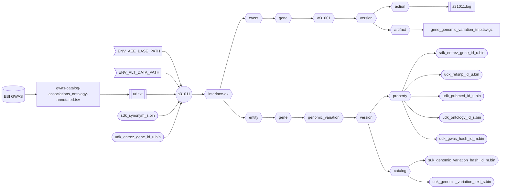
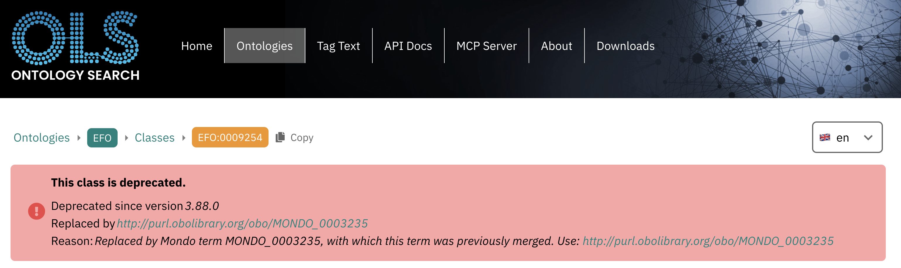

###### September 4, 2026: d60111 readme v13

# [a31011]

Creates the human **Gene Genomic Variation** asset from the EBI [GWAS Catalog].



##### Flowchart Legend

- ⬡ **Hexagons:** Interlace folder hierarchy
- ⛁ **Cylinders:** External data providers
- ◯ **Circles:** Interlace Go applications
- 𓉴 **Flags:** Environment variables
- 𓋰 **Ovals:** Interlace Go binary assets
- 𓈙 **Rectangles:** | Raw data files | or || configuration/log files ||

## Contents

1) [Help Page](#1-help-page)
2) [URI Input File](#2-uri-input-file)
3) [Requirements](#3-requirements)
4) [Environment Variables](#4-environment-variables)
5) [Command Line Example](#5-command-line-example)
6) [Log Example](#6-log-example)
7) [Missing EFO Identifiers](#7-missing-efo-identifiers)
8) [Output Example](#8-output-example)

### 1. Help Page

The help page is available with the `-help` option or when no arguments are provided.

```text
Project: interlace-ex
AppName: a31011
Version: beta_2026_08_31_15
Purpose: creates the Homo sapiens Gene entity Genomic Variation asset from the EBI GWAS Catalog.

Sources:

  1) GWAS_CATALOG
  2) GWAS_EFO
  3) hp.obo
  4) oba.obo
  5) gsso.obo
  6) mondo.obo
  7) sdk_synonym_s.bin
  8) udk_entrez_gene_id_u.bin

Options:

  -base-concept string
        Base concept ontology term to name the entity folder (default "gene")
  -base-path string
        Agent, event, and entity base path (default "/Users/foglio/interlace-ex")
  -config string
        Config file (optional)
  -data-path string
        Data path where to read and download files (default "/Users/foglio/interlace-ex/data")
  -event-time-tag string
        Event time tag (required) (default "20260904121637")
  -help
        Displays this help page
  -log string
        Logfile path to write stderr & stdout regardless of the -silent flag (default no log file)
  -loud
        Writes additional information if available
  -no-commit
        Disables committing the work
  -no-delete
        Disables deleting the artifact files
  -no-download
        Disables downloading data when necessary
  -silent
        Suppresses all standard output messages
  -uri-inp-file string
        URI list of URL, mailto, telnet, absolute-file-path#key (unique key as URI fragment), etc.
  -workflow-id string
        Workflow ID (default "w31001")
```

### 2. URI Input File

```text
# Persistent URI character sequences have constant file paths:
https://purl.obolibrary.org/obo/hp.obo
https://purl.obolibrary.org/obo/oba.obo
https://purl.obolibrary.org/obo/mondo.obo
https://raw.githubusercontent.com/Superraptor/GSSO/master/gsso.obo
# Non-persistent URI character sequences may not have a constant filename.
# Files with non-persistent URL are manually downloaded and declared as absolute file paths.
# Because their file names are unknown, the application looks for the unique URI fragment e.g., #GWAS_CATALOG appended at the end.
# https://ftp.ebi.ac.uk/pub/databases/gwas/releases/latest/gwas-catalog-associations_ontology-annotated-full.zip
file:///Users/foglio/interlace-ex/data/gwas-catalog-associations-annotated.tsv.gz#GWAS_CATALOG
# https://ftp.ebi.ac.uk/pub/databases/gwas/releases/latest/gwas-efo-trait-mappings.tsv
file:///Users/foglio/interlace-ex/data/gwas-efo-trait-mappings.tsv.gz#GWAS_EFO
```

### 3. Requirements
- Base path from the `-base-path` option or the environmental-variable `ENV_AEE_BASE_PATH`
- Data path from the `-data-path` option or the environmental-variable `ENV_ALT_DATA_PATH`
- URI list containing URLs and full-path file sources.

### 4. Environment Variables

```shell
ENV_AEE_BASE_PATH="${HOME}/interlace-ex"
ENV_ALT_DATA_PATH="${ENV_AEE_BASE_PATH}/data"
```

### 5. Command Line Example

```shell
a31011 -log a31011.log -event-time-tag 20260904150101 -uri-inp-file uri.txt
```

### 6. Log Example

```text
Inf: 2026/09/04 15:25:49.794233 application name: a31011
Inf: 2026/09/04 15:25:49.794380 application version: beta_2026_08_31_15
Inf: 2026/09/04 15:25:49.794393 application module: interlace-ex
Inf: 2026/09/04 15:25:49.794401 application aim: creates the Homo sapiens Gene entity Genomic Variation asset from the EBI GWAS Catalog.
Inf: 2026/09/04 15:25:49.794409 application start time tag: 20260904152549
Inf: 2026/09/04 15:25:49.794414 listing configuration variables ...
Inf: 2026/09/04 15:25:49.794423 APP_REVISION: 15
Inf: 2026/09/04 15:25:49.794427 BASE_CONCEPT: gene
Inf: 2026/09/04 15:25:49.794431 BASE_PATH: /Users/foglio/interlace-ex
Inf: 2026/09/04 15:25:49.794435 DATA_PATH: /Users/foglio/interlace-ex/data
Inf: 2026/09/04 15:25:49.794438 ENV_AEE_BASE_PATH: /Users/foglio/interlace-ex
Inf: 2026/09/04 15:25:49.794441 ENV_ALT_DATA_PATH: /Users/foglio/interlace-ex/data
Inf: 2026/09/04 15:25:49.794445 EVENT_TIME_TAG: 20260904150101
Inf: 2026/09/04 15:25:49.794448 HOME: /Users/foglio
Inf: 2026/09/04 15:25:49.794452 LOG_OUTPUT_FILE: a31011.log
Inf: 2026/09/04 15:25:49.794505 URI_INP_FILE: uri.txt
Inf: 2026/09/04 15:25:49.794512 USER_LOGIN_NAME: foglio
Inf: 2026/09/04 15:25:49.794516 USER_NAME: Mario Foglio
Inf: 2026/09/04 15:25:49.794519 WORKFLOW_ID: w31001
Inf: 2026/09/04 15:25:49.794523 setting up the refiner ...
Inf: 2026/09/04 15:25:49.795001 configured file[GWAS_CATALOG]=/Users/foglio/interlace-ex/data/gwas-catalog-associations-annotated.tsv.gz
Inf: 2026/09/04 15:25:49.795011 configured file[GWAS_EFO]=/Users/foglio/interlace-ex/data/gwas-efo-trait-mappings.tsv.gz
Inf: 2026/09/04 15:25:49.795387 file exists: /Users/foglio/interlace-ex/data/mondo.obo
Inf: 2026/09/04 15:25:49.795435 file exists: /Users/foglio/interlace-ex/data/hp.obo
Inf: 2026/09/04 15:25:49.795456 file exists: /Users/foglio/interlace-ex/data/gsso.obo
Inf: 2026/09/04 15:25:49.795469 file exists: /Users/foglio/interlace-ex/data/oba.obo
Inf: 2026/09/04 15:25:49.845989 creating the gene genomic variation asset ...
Inf: 2026/09/04 15:25:49.897307 total EFO Terms lines read: 110341
Inf: 2026/09/04 15:25:49.897358 total EFO Terms table rows examined: 110339
Inf: 2026/09/04 15:25:49.897364 total EFO Terms tuples created: 110339
Inf: 2026/09/04 15:25:49.918224 total HPO Terms lines read: 211112
Inf: 2026/09/04 15:25:49.918274 total HPO Terms table rows examined: 20413
Inf: 2026/09/04 15:25:49.918280 total HPO Terms tuples created: 20416
Inf: 2026/09/04 15:25:49.981178 total OBA Terms lines read: 748386
Inf: 2026/09/04 15:25:49.981227 total OBA Terms table rows examined: 83449
Inf: 2026/09/04 15:25:49.981233 total OBA Terms tuples created: 83708
Inf: 2026/09/04 15:25:49.991069 total GSSO Terms lines read: 102086
Inf: 2026/09/04 15:25:49.991110 total GSSO Terms table rows examined: 11570
Inf: 2026/09/04 15:25:49.991116 total GSSO Terms tuples created: 11462
Inf: 2026/09/04 15:25:50.072208 total MONDO Terms lines read: 928942
Inf: 2026/09/04 15:25:50.072234 total MONDO Terms table rows examined: 63267
Inf: 2026/09/04 15:25:50.072240 total MONDO Terms tuples created: 63455
Inf: 2026/09/04 15:25:54.276189 total EBI GWAS Catalog lines read: 1191574
Inf: 2026/09/04 15:25:54.276220 total EBI GWAS Catalog table rows examined: 1191572
Inf: 2026/09/04 15:25:54.276227 total EBI GWAS Catalog tuples created: 795158
Inf: 2026/09/04 15:25:54.276231 unique ontology IDs not found: 40
Inf: 2026/09/04 15:25:54.276235 tuples without ontology ID: 5031
Inf: 2026/09/04 15:25:54.422140 /Users/foglio/interlace-ex/event/gene/w31001/20260904150101/artifact/genomic_variation_1685672600.tsv.gz size: 44702469
Inf: 2026/09/04 15:25:58.233117 number of warnings caught: 0
Inf: 2026/09/04 15:25:58.233149 elapsed time just before closing: 8.439825542s
Inf: 2026/09/04 15:25:58.233155 end of process: complete
```

### 7. Missing EFO Identifiers

To inquire for a missing identifier, the EBI Ontology server can be queried as follows:

```text
https://www.ebi.ac.uk/ols4/ontologies/efo/classes?short_form=EFO_0009254
```



When the ontology ID is not found in the ontology reference data source, the `udk_ontology_id_s.bin` value is empty, but the `udk_gwas_hash_id_m.bin` value is not. The associated `uuk_genomic_variation_text_s.bin` entry always conserves the trait plain text data associated with the GWAS record.

### 8. Output Example

```text
interlace-ex/entity/gene/genomic_variation
└── 20260904150101
    ├── catalog
    │   ├── suk_genomic_variation_hash_id_m.bin
    │   └── uuk_genomic_variation_text_s.bin
    ├── enumeration
    └── property
        ├── sdk_entrez_gene_id_u.bin
        ├── udk_gwas_hash_id_m.bin
        ├── udk_ontology_id_s.bin
        ├── udk_pubmed_id_u.bin
        └── udk_refsnp_id_u.bin

interlace-ex/entity/gene/product
└── 20260904150101
    ├── catalog
    ├── enumeration
    │   └── uuk_synonym_category_cv_s.bin
    └── property
        ├── sdk_entrez_gene_id_u.bin
        ├── udk_protein_id_s.bin
        ├── udk_synonym_category_cv_d.bin
        └── udk_synonym_s.bin
       
interlace-ex/event/gene/w31001 
└── 20260904150101
    ├── action
    │   ├── 20260904151330_a31001.log
    │   ├── 20260904151952_a31002.log
    │   └── 20260904152558_a31011.log
    ├── artifact
    └── function
```

[a31011]: ../../internal/app/a31011
[GWAS Catalog]: https://www.ebi.ac.uk/gwas/
