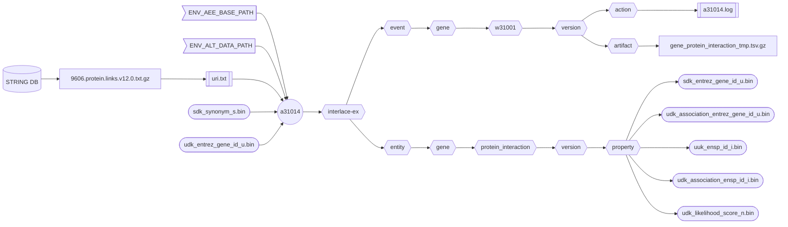

###### September 4, 2026: d60114 readme v13

# [a31014]

Creates the human **Gene Protein Interaction** asset from the [STRING DB].



##### Flowchart Legend

- ⬡ **Hexagons:** Interlace folder hierarchy
- ⛁ **Cylinders:** External data providers
- ◯ **Circles:** Interlace Go applications
- 𓉴 **Flags:** Environment variables
- 𓋰 **Ovals:** Interlace Go binary assets
- 𓈙 **Rectangles:** | Raw data files | or || configuration/log files ||

## Contents

1) [Help Page](#1-help-page)
2) [URI Input File](#2-uri-input-file)
3) [Requirements](#3-requirements)
4) [Environment Variables](#4-environment-variables)
5) [Command Line Example](#5-command-line-example)
6) [Log Example](#6-log-example)
7) [Output Example](#7-output-example)

### 1. Help Page

The help page is available with the `-help` option or when no arguments are provided.

```text
Project: interlace-ex
AppName: a31014
Version: beta_2026_08_31_15
Purpose: creates the Homo sapiens Gene entity Protein Interaction asset from the STRING DB.

Sources:

  1) STRING_DB
  2) sdk_synonym_s.bin
  3) udk_entrez_gene_id_u.bin

Options:

  -base-concept string
        Base concept ontology term to name the entity folder (default "gene")
  -base-path string
        Agent, event, and entity base path (default "/Users/foglio/interlace-ex")
  -config string
        Config file (optional)
  -data-path string
        Data path where to read and download files (default "/Users/foglio/interlace-ex/data")
  -event-time-tag string
        Event time tag (required) (default "20260904123730")
  -help
        Displays this help page
  -log string
        Logfile path to write stderr & stdout regardless of the -silent flag (default no log file)
  -loud
        Writes additional information if available
  -no-commit
        Disables committing the work
  -no-delete
        Disables deleting the artifact files
  -no-download
        Disables downloading data when necessary
  -silent
        Suppresses all standard output messages
  -uri-inp-file string
        URI list of URL, mailto, telnet, absolute-file-path#key (unique key as URI fragment), etc.
  -workflow-id string
        Workflow ID (default "w31001")
```

### 2. URI Input File

```text
# Non-persistent URI character sequences may not have a constant filename.
# Files with non-persistent URL are manually downloaded and declared as absolute file paths.
# Because their file names are unknown, the application looks for the unique URI fragment e.g., #STRING_DB appended at the end.
# https://stringdb-downloads.org/download/protein.links.v12.0/9606.protein.links.v12.0.txt.gz
file:///Users/foglio/interlace-ex/data/string-protein-links.tsv.gz#STRING_DB
```

### 3. Requirements
- Base path from the `-base-path` option or the environmental-variable `ENV_AEE_BASE_PATH`
- Data path from the `-data-path` option or the environmental-variable `ENV_ALT_DATA_PATH`
- URI list containing URLs and full-path file sources.

### 4. Environment Variables

```shell
ENV_AEE_BASE_PATH="${HOME}/interlace-ex"
ENV_ALT_DATA_PATH="${ENV_AEE_BASE_PATH}/data"
```

### 5. Command Line Example

```shell
a31014 -log a31014.log -event-time-tag 20260904150101 -uri-inp-file uri.txt
```

### 6. Log Example

```text
Inf: 2026/09/04 16:04:23.469003 application name: a31014
Inf: 2026/09/04 16:04:23.469077 application version: beta_2026_08_31_15
Inf: 2026/09/04 16:04:23.469090 application module: interlace-ex
Inf: 2026/09/04 16:04:23.469096 application aim: creates the Homo sapiens Gene entity Protein Interaction asset from the STRING DB.
Inf: 2026/09/04 16:04:23.469102 application start time tag: 20260904160423
Inf: 2026/09/04 16:04:23.469106 listing configuration variables ...
Inf: 2026/09/04 16:04:23.469128 APP_REVISION: 15
Inf: 2026/09/04 16:04:23.469131 BASE_CONCEPT: gene
Inf: 2026/09/04 16:04:23.469135 BASE_PATH: /Users/foglio/interlace-ex
Inf: 2026/09/04 16:04:23.469139 DATA_PATH: /Users/foglio/interlace-ex/data
Inf: 2026/09/04 16:04:23.469143 ENV_AEE_BASE_PATH: /Users/foglio/interlace-ex
Inf: 2026/09/04 16:04:23.469146 ENV_ALT_DATA_PATH: /Users/foglio/interlace-ex/data
Inf: 2026/09/04 16:04:23.469150 EVENT_TIME_TAG: 20260904150101
Inf: 2026/09/04 16:04:23.469154 HOME: /Users/foglio
Inf: 2026/09/04 16:04:23.469157 LOG_OUTPUT_FILE: a31014.log
Inf: 2026/09/04 16:04:23.469161 URI_INP_FILE: uri.txt
Inf: 2026/09/04 16:04:23.469164 USER_LOGIN_NAME: foglio
Inf: 2026/09/04 16:04:23.469168 USER_NAME: Mario Foglio
Inf: 2026/09/04 16:04:23.469171 WORKFLOW_ID: w31001
Inf: 2026/09/04 16:04:23.469174 setting up the refiner ...
Inf: 2026/09/04 16:04:23.469637 configured file[STRING_DB]=/Users/foglio/InterlaceEx/data/string-protein-links.tsv.gz
Inf: 2026/09/04 16:04:23.622821 creating the gene protein interaction asset ...
Inf: 2026/09/04 16:04:23.662572 not found: ENSP00000053469
Inf: 2026/09/04 16:04:23.668298 not found: ENSP00000074304
Inf: 2026/09/04 16:04:23.674537 not found: ENSP00000155858
... 
... cut for brevity
...
Inf: 2026/09/04 16:04:30.736254 not found: ENSP00000501092
Inf: 2026/09/04 16:04:30.736927 not found: ENSP00000501111
Inf: 2026/09/04 16:04:30.740688 not found: ENSP00000501317
Inf: 2026/09/04 16:04:30.740710 total STRING DB rows counted: 13715406
Inf: 2026/09/04 16:04:30.740715 total STRING DB records with GeneID: 18901
Inf: 2026/09/04 16:04:30.740718 total STRING DB records with no GeneID: 721
Inf: 2026/09/04 16:05:01.608552 not found: ENSP00000053469
Inf: 2026/09/04 16:05:01.615966 not found: ENSP00000074304
Inf: 2026/09/04 16:05:01.623366 not found: ENSP00000155858
... 
... cut for brevity
...
Inf: 2026/09/04 16:05:10.410974 not found: ENSP00000501092
Inf: 2026/09/04 16:05:10.411198 not found: ENSP00000501111
Inf: 2026/09/04 16:05:10.417141 not found: ENSP00000501317
Inf: 2026/09/04 16:05:10.417174 total protein interaction rows counted: 13396825
Inf: 2026/09/04 16:05:10.417181 total protein interaction records with GeneID: 18901
Inf: 2026/09/04 16:05:10.417185 total protein interaction records with no GeneID: 721
Inf: 2026/09/04 16:05:10.418988 /Users/foglio/interlace-ex/event/gene/w31001/20260904150101/artifact/protein_interaction_3373136598.tsv.gz size: 381565298
Inf: 2026/09/04 16:06:04.190097 number of warnings caught: 0
Inf: 2026/09/04 16:06:04.190119 elapsed time just before closing: 1m40.722587792s
Inf: 2026/09/04 16:06:04.190124 end of process: complete
```

### 7. Output Example

```text
interlace-ex/entity/gene/protein_interaction
└── 20260904150101
    ├── catalog
    ├── enumeration
    └── property
        ├── sdk_entrez_gene_id_u.bin
        ├── udk_association_ensp_id_i.bin
        ├── udk_association_entrez_gene_id_u.bin
        ├── udk_ensp_id_i.bin
        └── udk_likelihood_score_n.bin

interlace-ex/event/gene/w31001
└── 20260904150101
    ├── action
    │   ├── 20260904151330_a31001.log
    │   ├── 20260904151952_a31002.log
    │   ├── 20260904152558_a31011.log
    │   ├── 20260904153405_a31003.log
    │   ├── 20260904153833_a31004.log
    │   ├── 20260904154142_a31005.log
    │   ├── 20260904154456_a31006.log
    │   ├── 20260904154823_a31007.log
    │   ├── 20260904155052_a31008.log
    │   ├── 20260904155318_a31009.log
    │   ├── 20260904155712_a31010.log
    │   ├── 20260904155932_a31012.log
    │   ├── 20260904160145_a31013.log
    │   └── 20260904160604_a31014.log
    ├── artifact
    └── function
```

[a31014]: ../../internal/app/a31014
[STRING DB]: https://string-db.org/
